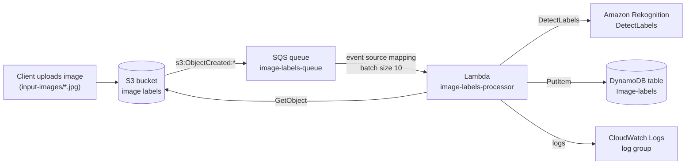
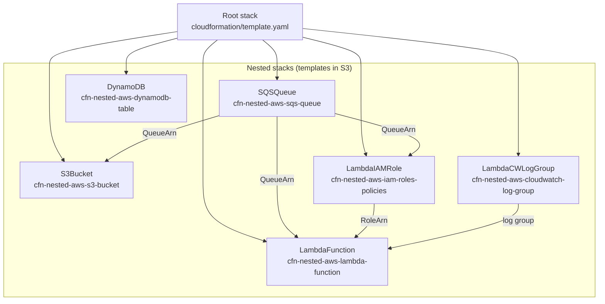

# AI Agent on AWS with AgentCore (Backend Microservice)

<!-- Row 1: Status - Most Important -->
[](https://github.com/subhamay-bhattacharyya/elara-backend-microservice/releases)&nbsp;[](https://github.com/subhamay-bhattacharyya/elara-backend-microservice/actions/workflows/release.yaml)&nbsp;[](https://github.com/subhamay-bhattacharyya/elara-backend-microservice/issues)&nbsp;[](https://github.com/subhamay-bhattacharyya/elara-backend-microservice/commits)

<!-- Row 2: Code Quality -->
[](https://github.com/subhamay-bhattacharyya/elara-backend-microservice)&nbsp;[](https://github.com/subhamay-bhattacharyya/elara-backend-microservice/commits)

<!-- Row 3: Tech Stack -->
[](https://aws.amazon.com/cloudformation/)&nbsp;[](https://claude.ai/)

<!-- Row 4: Repository Info -->
[](https://github.com/subhamay-bhattacharyya/elara-backend-microservice)&nbsp;[](https://github.com/subhamay-bhattacharyya/elara-backend-microservice)&nbsp;[](https://github.com/subhamay-bhattacharyya/elara-backend-microservice/releases)

<!-- Row 5: Custom Metrics -->
[](https://gist.github.com/subhamay-bhattacharyya/362a2e07d18e1523e89c6ed1dc627474)

## Architecture

### Runtime Flow



1. An image uploaded under `input-images/` with a `.jpg` suffix triggers an `s3:ObjectCreated:*` notification.
2. The notification is delivered to the SQS queue, which the Lambda reads through an event source mapping.
3. The Lambda reads the S3 object, calls Rekognition to detect labels, and writes the item to the DynamoDB table.

### Deployment Stack



The root stack creates the queue first, then the bucket notification and the Lambda's permissions reference the queue's ARN. The Lambda function receives its execution role from the IAM stack.

## CI/CD Pipeline

The pipeline is built on GitHub Actions and deploys the CloudFormation stack and the Lambda function to AWS. It authenticates to AWS with OIDC (`id-token: write`), so no long-lived AWS keys are stored in the repository.

### Workflows

| Workflow | Trigger | What it does |
| -------- | ------- | ------------ |
| `ci.yaml` (CI Build) | Manual; push to `main`, `feature/**`, `bug/**`; PR into `main` | Reads `cloudformation/stack-config.json`, runs the reusable CI build for the stack, then on `main` generates the changelog and creates a release |
| `deploy-lambda.yaml` (Build and Deploy Lambda) | Manual, with an environment choice | Reads the Lambda settings from the GitHub environment, builds the `lambda/image-labels-processor` package, uploads it to S3, and deploys it |
| `setup-environments.yaml` (Setup AWS Environments) | Manual | Creates the AWS environments used by the other workflows |
| `create-branch.yaml` (Auto Create Branch) | Issue assigned | Creates a `CFN-<issue>-<title>` feature branch for the issue |
| `notify.yaml` (Slack Notification) | PR or issue opened | Sends a Slack message through the shared notification workflow |
| `claude-code-review.yaml`, `claude.yaml` | PR opened or updated; `@claude` mentions | Runs an automated Claude code review on PRs and responds to `@claude` in issues and PRs |

### CI Build and Release

1. **Trigger.** CI runs only when files under `cloudformation/`, `lambda/image-labels-processor/`, or the CI workflow itself change.
2. **Load configuration.** The `load-config` job reads `stackName`, `templateFile`, and `parameterFile` from `cloudformation/stack-config.json` and writes them to the job summary.
3. **Build and validate.** The `ci-build` job calls the shared `cfn-ci-build-reusable-wf` workflow with the `ci` environment and the stack configuration.
4. **Changelog (main only).** `generate-changelog` runs `git-cliff` against `cliff.toml`, commits `CHANGELOG.md` with `[skip ci]`, and pushes it.
5. **Release (main only).** `create-release` runs after the build succeeds and publishes a GitHub release.

### Lambda Deployment

`deploy-lambda.yaml` is started manually and takes the target GitHub environment as input. The `config` job reads these values from the environment:

- `AWS_ENVIRONMENT`, `AWS_REGION`, `AWS_ACCOUNT_ID`, `AWS_OIDC_ROLE_NAME`
- `LAMBDA_PACKAGES_S3_BUCKET_NAME` (where the packaged code is uploaded)
- `PYTHON_VERSION`

The function name is `proj-ztc-image-labels-processor-<environment>-<region>`. The `deploy` job calls the shared `lambda-build-deploy-reusable-wf` workflow, and the `summary` job prints the S3 URI of the deployed package.

### Setup Notes

- The `ci` GitHub environment must trust the OIDC role and provide the `CFN_TEMPLATES_S3_BUCKET` variable.
- Commit messages must follow the Conventional Commits format (`feat:`, `fix:`, `BREAKING CHANGE:`) so that the changelog and release versions are generated correctly.

This repository contains nested CloudFormation templates for deploying S3 buckets with security best practices and optional policy enforcement.

## Overview

This is a **nested stack template** designed to be invoked from a parent/root CloudFormation stack. Templates are stored in this repository and should be uploaded to an S3 bucket for reference by parent stacks.

## Template Files

### CloudFormation Templates

- **`templates/s3-bucket.yaml`** — Nested template for S3 bucket creation (versioning, public access blocking)
- **`templates/s3-bucket-policy.yaml`** — Optional nested template for S3 bucket policy (encryption enforcement, secure transport)

### Parameter Files

- **`parameters/parameters.json`** — Parameter values for development environment

## Template Features

### S3 Bucket Template (s3-bucket.yaml)

- ✅ Versioning enabled by default
- ✅ Public Access Blocking
- ✅ Smart bucket naming (project prefix, account ID, environment, region)
- ✅ Optional CI suffix support

### S3 Bucket Policy Template (s3-bucket-policy.yaml)

- ✅ Encryption enforcement on uploads
- ✅ Secure transport enforcement (HTTPS only)
- ✅ Optional/conditional policy rules

## Parameters

### S3 Bucket Parameters

| Parameter | Type | Default | Description |
| ----------- | ------ | --------- | ------------- |
| `ProjectName` | String | — | Project name to use as bucket prefix (required) |
| `BucketBaseName` | String | `cfn-bucket` | Base name for S3 bucket |
| `environment` | String | `devl` | Deployment environment (devl, stag, prod) |
| `CiSuffix` | String | `""` | Optional CI suffix to append to bucket name |

### S3 Bucket Policy Parameters

**Generic (Standalone) Mode:**

| Parameter | Type | Description |
| ----------- | ------ | ------------- |
| `BucketName` | String | Direct bucket name (use for any bucket) |

**Integrated Mode (with bucket template):**

| Parameter | Type | Default | Description |
| ----------- | ------ | --------- | ------------- |
| `ProjectName` | String | — | Project name (must match bucket template) |
| `BucketBaseName` | String | `cfn-bucket` | Base name (must match bucket template) |
| `environment` | String | `devl` | Environment (must match bucket template) |
| `CiSuffix` | String | `""` | CI suffix (must match bucket template) |

**Usage:** If `BucketName` is provided (non-empty), it takes precedence. Otherwise, the bucket name is constructed from ProjectName/BucketBaseName/environment/CiSuffix.

## Outputs

### S3 Bucket Template Outputs

- `S3BucketName` — S3 bucket name
- `S3BucketArn` — S3 bucket ARN

### S3 Bucket Policy Template Outputs

- `BucketName` — Bucket name with policy applied
- `PolicyStatus` — Policy application status (Applied)

## Usage

### 1. Upload Templates to S3

```bash
aws s3 cp templates/s3-bucket.yaml s3://your-cfn-bucket/templates/s3-bucket.yaml
aws s3 cp templates/s3-bucket-policy.yaml s3://your-cfn-bucket/templates/s3-bucket-policy.yaml
```

### 2. Reference from Parent Stack

In your parent/root CloudFormation template:

```yaml
S3BucketNestedStack:
  Type: AWS::CloudFormation::Stack
  Properties:
    TemplateURL: https://s3.amazonaws.com/your-cfn-bucket/templates/s3-bucket.yaml
    Parameters:
      ProjectName: !Ref ProjectName
      BucketBaseName: cfn-bucket
      environment: !Ref Environment
      CiSuffix: !Ref CiSuffix
    Tags:
      - Key: Environment
        Value: !Ref Environment

S3PolicyNestedStack:
  Type: AWS::CloudFormation::Stack
  DependsOn: S3BucketNestedStack
  Properties:
    TemplateURL: https://s3.amazonaws.com/your-cfn-bucket/templates/s3-bucket-policy.yaml
    Parameters:
      BucketName: !GetAtt S3BucketNestedStack.Outputs.S3BucketName
      ProjectName: ""
      BucketBaseName: cfn-bucket
      environment: !Ref Environment
      CiSuffix: !Ref CiSuffix
    Tags:
      - Key: Environment
        Value: !Ref Environment

Outputs:
  BucketName:
    Value: !GetAtt S3BucketNestedStack.Outputs.S3BucketName
  BucketArn:
    Value: !GetAtt S3BucketNestedStack.Outputs.S3BucketArn
```

### 3. Deploy Using AWS CLI

#### Option A: Deploy Bucket Only

```bash
# Development (without CI prefix)
aws cloudformation create-stack \
  --stack-name cfn-s3-bucket-dev \
  --template-body file://templates/s3-bucket.yaml \
  --parameters file://parameters/dev.json

# Staging (without CI prefix)
aws cloudformation create-stack \
  --stack-name cfn-s3-bucket-stag \
  --template-body file://templates/s3-bucket.yaml \
  --parameters file://parameters/staging.json

# Production (without CI prefix)
aws cloudformation create-stack \
  --stack-name cfn-s3-bucket-prod \
  --template-body file://templates/s3-bucket.yaml \
  --parameters file://parameters/prod.json
```

#### Option B: Deploy Bucket + Policy (Recommended)

```bash
# Deploy bucket first
aws cloudformation create-stack \
  --stack-name cfn-s3-bucket-dev \
  --template-body file://templates/s3-bucket.yaml \
  --parameters file://parameters/dev.json

# Wait for bucket to be created
aws cloudformation wait stack-create-complete --stack-name cfn-s3-bucket-dev

# Get the bucket name from stack outputs
BUCKET_NAME=$(aws cloudformation describe-stacks \
  --stack-name cfn-s3-bucket-dev \
  --query 'Stacks[0].Outputs[?OutputKey==`S3BucketName`].OutputValue' \
  --output text)

#### Using Integrated Mode (with bucket template parameters)

```bash
aws cloudformation create-stack \
  --stack-name cfn-s3-policy-dev \
  --template-body file://templates/s3-bucket-policy.yaml \
  --parameters file://parameters/policy-dev.json
```

#### Using Generic Mode (standalone with direct bucket name)

```bash
aws cloudformation create-stack \
  --stack-name cfn-s3-policy-dev \
  --template-body file://templates/s3-bucket-policy.yaml \
  --parameters \
    ParameterKey=BucketName,ParameterValue=my-existing-bucket \
    ParameterKey=ProjectName,ParameterValue=""
```

#### Option C: Deploy with CI Suffix

```bash
# Development with CI suffix (e.g., for GitLab CI)
aws cloudformation create-stack \
  --stack-name cfn-s3-bucket-dev-ci \
  --template-body file://templates/s3-bucket.yaml \
  --parameters \
    ParameterKey=ProjectName,ParameterValue=myproject \
    ParameterKey=BucketBaseName,ParameterValue=cfn-bucket \
    ParameterKey=environment,ParameterValue=devl \
    ParameterKey=CiSuffix,ParameterValue=$CI_PIPELINE_ID
```

## Bucket Naming Convention

The templates generate bucket names using the following pattern:

**Without CI Suffix:**

```bash
{ProjectName}-{BucketBaseName}-{AccountId}-{Environment}-{Region}
```

Example: `myproject-cfn-bucket-123456789012-devl-us-east-1`

**With CI Suffix:**

```bash
{ProjectName}-{BucketBaseName}-{AccountId}-{Environment}-{Region}-{CiSuffix}
```

Example: `myproject-cfn-bucket-123456789012-devl-us-east-1-pipeline-12345`

## Best Practices Implemented

- ✅ Versioning enabled by default
- ✅ Public access blocked by default
- ✅ Smart bucket naming with project prefix, account ID, environment, and region
- ✅ Optional CI suffix support for unique deployments
- ✅ Optional policy enforcement (encryption and secure transport)
- ✅ Export values for cross-stack references

## License

MIT